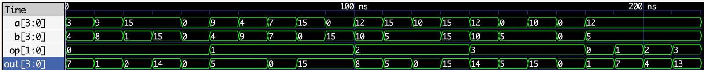

# Laboratorio 02  
## Lab02: Diseño, simulación e implementación de una ALU de 4 bits

---

## Integrantes

- Juan Sebastián Florez Payares
- Juan Esteban Barrera Ortiz
- Carlos Andrés Herrera Molina
- Luciano Manrique Medina

**Grupo de trabajo: 3**  
**Semestre:** 2026-1  

---

## Índice

- [Diseño implementado](#diseño-implementado)
- [Operaciones implementadas](#operaciones-implementadas)
- [Almacenamiento de operandos y código de operación](#almacenamiento-de-operandos-y-código-de-operación)
- [Indicador LED RGB](#indicador-led-rgb)
- [Simulaciones](#simulaciones)
- [Implementación en FPGA](#implementación-en-fpga)
- [Conclusiones](#conclusiones)
- [Referencias](#referencias)

---

## Diseño implementado

En esta sección se presenta el funcionamiento general de la ALU de 4 bits, 
la arquitectura propuesta y los módulos desarrollados.

---

## Operaciones implementadas

En esta sección se presentan las operaciones aritméticas y lógicas implementadas
en la ALU y sus respectivos códigos de operación.

### Suma (`op = 00`)

Usa el sumador de 4 bits en cascada, formado por cuatro sumadores completos. Cada `cout` se conecta al `cin` de la etapa siguiente.

```verilog
module sumador1(
    input a, b, cin,
    output sum, cout
);
    assign sum  = a ^ b ^ cin;
    assign cout = (a & b) | (cin & (a ^ b));
endmodule

module sumador4(
    input [3:0] a, b,
    input cin,
    output [3:0] sum,
    output cout
);
    wire co1, co2, co3;

    sumador1 s1 (.a(a[0]), .b(b[0]), .cin(cin), .sum(sum[0]), .cout(co1));
    sumador1 s2 (.a(a[1]), .b(b[1]), .cin(co1), .sum(sum[1]), .cout(co2));
    sumador1 s3 (.a(a[2]), .b(b[2]), .cin(co2), .sum(sum[2]), .cout(co3));
    sumador1 s4 (.a(a[3]), .b(b[3]), .cin(co3), .sum(sum[3]), .cout(cout));
endmodule
```

En la ALU se instancia con `cin = 0`:

```verilog
sumador4 sumalab2 (.a(a), .b(b), .cin(1'b0), .sum(suma), .cout());
```

### Resta (`op = 01`)

Se implementa en complemento a 2 como `A + ~B + 1`, reutilizando el sumador:

```verilog
module restador(
    input [3:0] a, b,
    output [3:0] resta
);
    sumador4 resta1 (.a(a), .b(~b), .cin(1'b1), .sum(resta), .cout());
endmodule
```

La ALU calcula `A - B` y `B - A` en paralelo, y un comparador selecciona la diferencia del mayor menos el menor:

```verilog
restador restalab2  (.a(a), .b(b), .resta(resta1));   // A - B
restador restalab22 (.a(b), .b(a), .resta(resta2));   // B - A

assign a_ge_b = (a >= b);
assign resta  = a_ge_b ? resta1 : resta2;             // |A - B|
```

### AND (`op = 10`)

Se aplica bit a bit entre los operandos:

```verilog
(a & b)
```

### OR (`op = 11`)

Se aplica bit a bit entre los operandos:

```verilog
(a | b)
```

### Selección de la operación

El código `op` elige cuál de los resultados llega a la salida:

```verilog
assign out = (op == 2'b00) ? suma  :
             (op == 2'b01) ? resta :
             (op == 2'b10) ? (a & b) :
                             (a | b);   // op == 2'b11
```

## Almacenamiento de operandos y código de operación

En esta sección se explica cómo se ingresan y almacenan los operandos A y B, así como la forma en que se conserva el código de operación seleccionado.

### Entradas

Los valores se ingresan con los switches `X[3:0]` y se guardan al pulsar un botón. Cada botón pasa por un módulo de antirrebote que entrega un pulso (`pA`, `pB`, `pOp0`, `pOp1`) cuando se presiona.

```verilog
input  guardarA,        // BTN0
input  guardarB,        // BTN1
input  opBit0,          // BTN2
input  opBit1,          // BTN3
input  [3:0] X,         // switches

antirebote dbA   (.clk(clk), .btn(guardarA), .pulso(pA));
antirebote dbB   (.clk(clk), .btn(guardarB), .pulso(pB));
antirebote dbOp0 (.clk(clk), .btn(opBit0),   .pulso(pOp0));
antirebote dbOp1 (.clk(clk), .btn(opBit1),   .pulso(pOp1));
```

### Registros

Los operandos y el código de operación se conservan en registros, inicializados en cero:

```verilog
reg [3:0] a  = 4'b0000;   // operando A
reg [3:0] b  = 4'b0000;   // operando B
reg [1:0] op = 2'b00;     // código de operación
```

### Almacenamiento

En cada flanco de subida del reloj, si hay pulso de un botón, se carga el valor de los switches en el registro correspondiente:

```verilog
always @(posedge clk) begin
    if (pA)   a     <= X;      // BTN0: guarda A = X[3:0]
    if (pB)   b     <= X;      // BTN1: guarda B = X[3:0]
    if (pOp0) op[0] <= X[0];   // BTN2: guarda op[0] = X[0]
    if (pOp1) op[1] <= X[1];   // BTN3: guarda op[1] = X[1]
end
```

Los valores se conservan hasta que se vuelve a pulsar el botón correspondiente, por lo que mover los switches después de guardar no modifica `a`, `b` ni `op`.

### Procedimiento de uso

| Paso | Switches `X` | Botón | Efecto |
|:----:|:------------:|:-----:|--------|
| 1 | Valor de A (4 bits) | BTN0 | Se guarda A |
| 2 | Valor de B (4 bits) | BTN1 | Se guarda B |
| 3 | `X[0]` = bit 0 del código | BTN2 | Se guarda `op[0]` |
| 4 | `X[1]` = bit 1 del código | BTN3 | Se guarda `op[1]` |

### Conexión con la ALU

Los registros alimentan directamente la ALU, así que el resultado depende solo de los valores almacenados:

```verilog
alu alulab2 (.a(a), .b(b), .op(op), .out(out));
```

## Identificación de operaciones mediante LED RGB

Para facilitar la identificación de la operación seleccionada en la ALU, se utiliza un LED RGB de la FPGA. El color mostrado depende del código de operación almacenado en el registro `op[1:0]`. De esta forma, es posible identificar visualmente qué operación está ejecutando la ALU antes de observar el resultado en los LEDs de salida.

| Código `op[1:0]` | Operación | Salida `rgb[2:0]` | Color |
|:---:|:---:|:---:|:---:|
| `00` | Suma  | `010` | Verde |
| `01` | Resta | `100` | Rojo |
| `10` | AND   | `101` | Morado |
| `11` | OR    | `110` | Amarillo |

La selección del color se realiza en el módulo principal mediante una estructura `case`, relacionando cada código de operación con una combinación específica de las tres componentes del LED RGB. Esto permite utilizar el LED como un indicador visual del estado actual de la ALU.

---

## Simulaciones

Para verificar el funcionamiento de la ALU se desarrolló un testbench en el archivo `tb_alu.v`, en el cual se probaron las cuatro operaciones implementadas: suma, resta, AND y OR. Durante la simulación se modificaron los operandos `a` y `b` junto con el código de operación `op`, observando el resultado obtenido en la señal `out`.

Las señales utilizadas para verificar el comportamiento fueron:

- `a[3:0]`: primer operando de 4 bits.
- `b[3:0]`: segundo operando de 4 bits.
- `op[1:0]`: código utilizado para seleccionar la operación.
- `out[3:0]`: resultado de 4 bits generado por la ALU.

La simulación fue realizada con **Icarus Verilog** y las señales obtenidas fueron visualizadas mediante **GTKWave** en formato decimal.

### Evidencia GTKWave



En la simulación se observa inicialmente la operación de suma (`op = 0`). Para valores dentro del rango de 4 bits se obtiene directamente el resultado esperado, como `3 + 4 = 7`. También se verificaron casos de desbordamiento, como `9 + 8 = 17`, donde la salida observada es `1`, debido a que `out` tiene únicamente 4 bits y no almacena el acarreo de salida.

Posteriormente, con `op = 1`, se verifica la resta. El diseño obtiene la diferencia entre los operandos sin producir resultados negativos. Por ejemplo, tanto `9 - 4` como la combinación inversa con `4` y `9` producen una salida igual a `5`. Cuando ambos operandos son iguales, la salida obtenida es `0`.

Para `op = 2` se comprueba la operación lógica AND bit a bit. Por ejemplo, utilizando `a = 12` y `b = 10` se obtiene `out = 8`, correspondiente a la operación binaria `1100 AND 1010 = 1000`.

Con `op = 3` se verifica la operación lógica OR. Para los mismos operandos, `a = 12` y `b = 10`, se obtiene `out = 14`, correspondiente a `1100 OR 1010 = 1110`.

Finalmente, al final de la simulación se mantienen constantes los operandos `a = 12` y `b = 5` mientras se modifica únicamente el código `op`. Los resultados obtenidos son:

| `op` | Operación | Resultado observado |
|:---:|:---:|:---:|
| `0` | Suma | `1` |
| `1` | Resta | `7` |
| `2` | AND | `4` |
| `3` | OR | `13` |

Esta última prueba permite comprobar que el código de operación selecciona correctamente cada una de las funciones de la ALU manteniendo los mismos operandos de entrada. En conjunto, los resultados observados coinciden con el comportamiento esperado para las cuatro operaciones implementadas.


---

## Implementación en FPGA

El diseño fue implementado físicamente en la tarjeta **Zybo Z7**, utilizando los switches y pulsadores disponibles en la FPGA para ingresar los operandos y seleccionar la operación. Los cuatro switches permiten establecer valores binarios de 4 bits, mientras que los pulsadores permiten almacenar los operandos `A` y `B` y configurar el código de operación.

Una vez almacenados los operandos y seleccionada la operación, la ALU realiza el cálculo de forma combinacional. El resultado de 4 bits se muestra mediante los LEDs de la tarjeta, mientras que el LED RGB permite identificar visualmente la operación seleccionada de acuerdo con la tabla definida anteriormente.

Para evitar que los rebotes mecánicos de los pulsadores generen múltiples registros durante una sola pulsación, las entradas de los botones pasan por un módulo de antirrebote antes de ser utilizadas para almacenar los datos.

### Evidencia

A continuación se presenta un video del funcionamiento del diseño implementado físicamente en la tarjeta **Zybo Z7**. En este se observa el ingreso y almacenamiento de los operandos mediante los switches y pulsadores, la selección de las diferentes operaciones de la ALU, la visualización del resultado mediante los LEDs y el cambio de color del LED RGB de acuerdo con la operación seleccionada.


https://github.com/user-attachments/assets/3f3569e4-6894-4336-ad09-5f5430d34856


---

## Conclusiones

- La implementación de la ALU de 4 bits permitió integrar operaciones aritméticas y lógicas dentro de un mismo sistema, utilizando un código de operación de 2 bits para seleccionar entre suma, resta, AND y OR.

- La simulación mediante Icarus Verilog y GTKWave permitió verificar el comportamiento del diseño antes de implementarlo en la FPGA, incluyendo casos particulares como el desbordamiento en la suma debido a que la salida está limitada a 4 bits.

- La implementación en la Zybo Z7 permitió comprobar el funcionamiento del diseño en hardware, utilizando switches y pulsadores para ingresar y almacenar los datos, LEDs para visualizar el resultado y un LED RGB para identificar la operación seleccionada.
  
---

## Referencias
