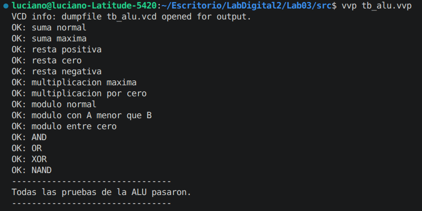
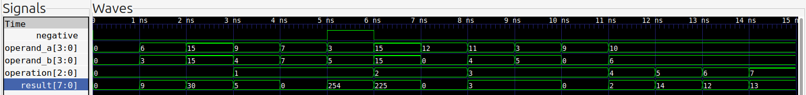
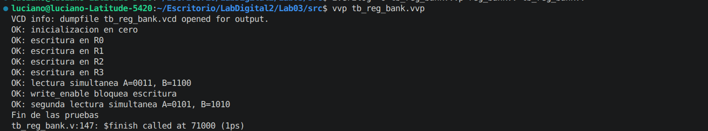
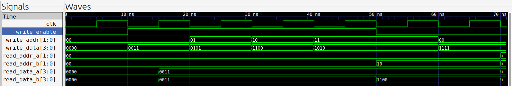
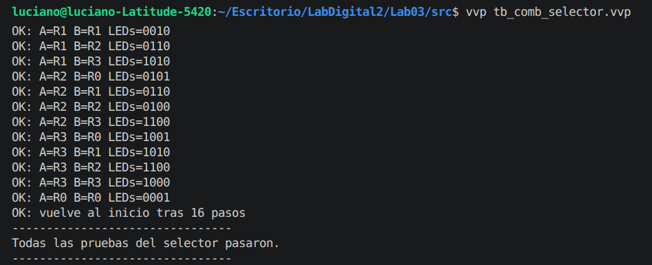
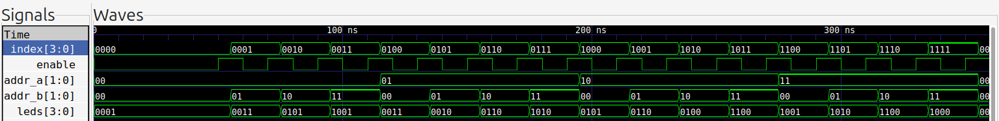
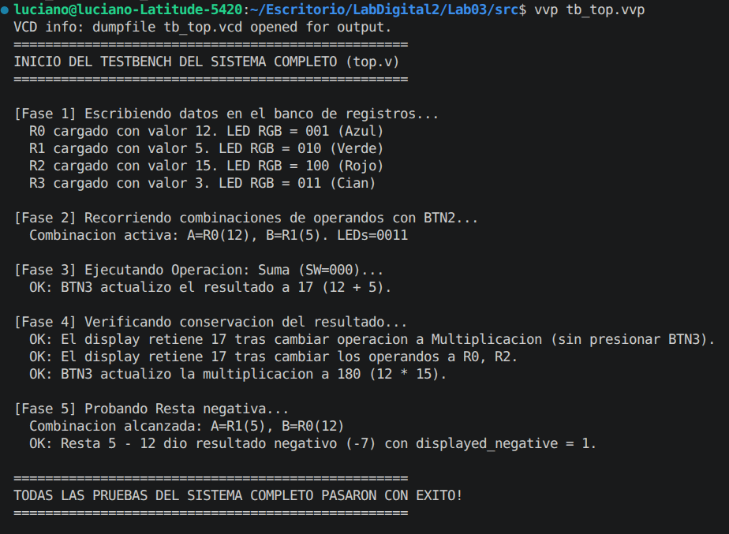
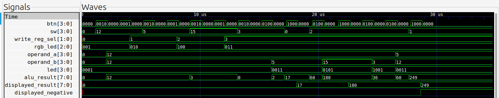

# Laboratorio 03
## Lab03: ALU + Banco de Registros + Diseño Modular

---

## Integrantes

- Juan Sebastián Florez Payares
- Juan Esteban Barrera Ortiz
- Carlos Andrés Herrera Molina
- Luciano Manrique Medina

**Grupo de trabajo: 3**  
**Semestre:** 2026-1

---

## Índice

- [Descripción del sistema](#descripción-del-sistema)
- [Arquitectura modular](#arquitectura-modular)
- [Interfaz de usuario](#interfaz-de-usuario)
- [Estrategia de visualización](#estrategia-de-visualización)
- [Simulaciones](#simulaciones)
- [Implementación en FPGA](#implementación-en-fpga)
- [Análisis de resultados](#análisis-de-resultados)
- [Conclusiones](#conclusiones)
- [Referencias](#referencias)

---

## Descripción del sistema

Para esta práctica se diseñó e implementó un **sistema digital modular sincrónico**. El sistema integra un banco de registros para almacenar los datos, un selector que recorre de forma secuencial las combinaciones de 2 operandos (de 4 bits), una ALU de 4 bits compuesta por 8 operaciones diferentes y que además cuenta con salida extendida a 8 bits para las operaciones aritméticas y lógicas, y un display **TM1637** de 4 dígitos y 7 segmentos para mostrar el resultado.

Una de las ideas centrales de este laboratorio era poder separar la etapa de cálculo de la visualización, o sea, que el display solo se actualice cuando se presiona el botón de ejecución (`BTN3`), donde el último resultado calculado se mantiene congelado aunque después se muevan los switches de dato/operación o se cambie la combinación de operandos activa.

---

### Mapeo de interfaz de usuario y periféricos (Zybo Z7)

Como usamos unicamente los botones de la FPGA Zybo Z7 (a excepción del reset), los switches se usaron para dos cosas distintas según la etapa en la que esté el usuario: cargar un dato o elegir la operación. La siguiente tabla resume cómo definimos esto:

| Recurso físico   | Identificador | Función en el sistema |
| :--------------- | :------------ | :-------------------- |
| Pulsador         | `BTN0`        | Selecciona de forma cíclica el registro de destino para escritura (R0 → R1 → R2 → R3 → R0). |
| Pulsador         | `BTN1`        | Genera la orden de escritura síncrona (`write_enable`) para cargar el valor de `SW[3:0]` en el registro seleccionado. |
| Pulsador         | `BTN2`        | Avanza a la siguiente combinación de operandos ($R_A$, $R_B$). |
| Pulsador         | `BTN3`        |  Captura el resultado actual de la ALU en el registro y refresca la pantalla. |
| Switches         | `SW[3:0]`     | Carga el dato numérico de 4 bits (0 a 15) que se almacena en el registro. |
| Switches         | `SW[2:0]`     |  selecciona la operación que ejecuta la ALU. |
| LED RGB          | `LED6`        | Indica con un color el registro seleccionado para escritura (`BTN0`). |
| LEDs individuales | `LD0 – LD3`  | Indican qué registros actúan como operandos $A$ y $B$ en la combinación actual. |
| Pmod JC          | Pines 1 y 2   | Líneas de comunicación serie `CLK` y `DIO` (bidireccional) hacia el módulo TM1637. |

#### Codificación del LED RGB para el registro de escritura

Para saber en todo momento en qué registro se va a escribir sin ocupar los LEDs de salida, se codificó cada registro con un color del LED RGB (`LED6`):

- **R0:** azul (`3'b001`)
- **R1:** verde (`3'b010`)
- **R2:** rojo (`3'b100`)
- **R3:** cian (`3'b011`)

---

### Tabla de operaciones de la ALU

La ALU opera sobre dos operandos de 4 bits (`operand_a` y `operand_b`) que entrega el banco de registros, y la operación se elige con los tres bits menos significativos de los switches (`SW[2:0]`):

| `SW[2:0]` | Operación      | Función lógica / aritmética | Ancho de salida         | Manejo de signo / casos borde |
|:---------:|----------------|-----------------------------|:-----------------------:|-------------------------------|
| `000`     | Suma           | $A + B$                     | 8 bits                  | Sin signo. |
| `001`     | Resta          | $A - B$                     | 8 bits ($-15$ a $15$)   | Los negativos se representan en complemento a dos con extensión de signo a 8 bits. Se activa `negative = 1` si $A < B$. |
| `010`     | Multiplicación | $A \times B$                | 8 bits (máx. 225)       | Es la operación que define el ancho de 8 bits ($15 \times 15 = 225$). |
| `011`     | Módulo         | $A \bmod B$                 | 8 bits                  | Si $B = 0$, devuelve $0$ para evitar indeterminaciones. |
| `100` | AND  | $A \land B$              | 8 bits | Operación bit a bit. |
| `101` | OR   | $A \mid B$                | 8 bits | Operación bit a bit. |
| `110` | XOR  | $A \oplus B$              | 8 bits | Operación bit a bit. |
| `111` | NAND | $\overline{A \land B}$   | 8 bits | Operación bit a bit invertida. |
---

### Flujo del usuario


1. **Carga del banco de registros:** se ajusta `SW[3:0]` con el dato deseado, se selecciona el registro destino con `BTN0` (observando el color del LED RGB) y se pulsa `BTN1` para almacenar el dato. Esto se repite para todos los registros que se necesiten.
2. **Selección de operandos:** con `BTN2` se recorren las 16 parejas posibles de operandos. Los LEDs individuales (`LD0–LD3`) se encienden para indicar qué registros están actuando como operandos $A$ y $B$.
3. **Selección de operación:** se configuran los switches `SW[2:0]` con el código de la operación que se quiere realizar.
4. **Ejecución y visualización:** se pulsa `BTN3`. En ese instante el resultado pasa al registro de visualización y se transmite al TM1637. El resultado queda fijo en el display hasta la siguiente ejecución.

---

## Arquitectura modular

Para este laboratorio el objetivo era usar el módulo superior (`top.v`) solamente como enrutador de señales y el puente encargado de integrar todos los demás módulos. Donde cada modulo tiene su propia lógica y cada uno se validó por medio de testbench.

### 2.1. Diagrama de bloques del sistema
A continuación, con ayuda de IA, se presenta el diagrama de bloques del diseño realizado.



*Figura 1. Diagrama de bloques del sistema. Imagen generada con IA*

---

### Módulo antirrebote y sincronizador (`debouncer.v`)

Debido a que pulsadores mecánicos presentan rebotes que pueden durar entre $5\text{ ms}$ y $20\text{ ms}$ y como la FPGA trabaja con un reloj de $125\text{ MHz}$ ($8\text{ ns}$ de periodo), con una sola pulsación se pueden generar falsas activaciones en el sistema.

Para evitarlo se implementó el módulo `debouncer.v`, que se instancia cuatro veces, una por botón.

---

### Banco de registros (`reg_bank.v`)

Es la memoria de operandos del sistema: un arreglo de 4 registros de 4 bits (`registers[0]` a `registers[3]`).

- **Escritura síncrona:** ocurre en el flanco de subida de `clk` solo si `write_enable` está en alto. En ese caso se escribe `write_data[3:0]` en la dirección indicada por `write_addr[1:0]`.
- **Lectura asíncrona dual:** son los dos puertos de lectura independientes (`read_data_a` y `read_data_b`), implementados con multiplexores combinacionales:

```verilog
  assign read_data_a = registers[read_addr_a];
  assign read_data_b = registers[read_addr_b];
```

  Con esto la ALU recibe ambos operandos al mismo tiempo.

---

### Selector de combinaciones (`comb_selector.v`)

Este módulo automatiza el recorrido por los pares de operandos posibles:

- Mantiene un contador interno de 4 bits (`index[3:0]`) que se incrementa en uno con cada pulso de `BTN2`.
- Separa el índice de forma que se cubren las 16 combinaciones posibles: $(R0, R0), (R0, R1), \dots, (R3, R3)$.
- **Decodificación de LEDs activos:** el LED $i$ se enciende si el registro $R_i$ está seleccionado como operando $A$, como operando $B$, o como ambos a la vez:

```verilog
  assign leds[0] = (addr_a == 2'd0) || (addr_b == 2'd0);
  assign leds[1] = (addr_a == 2'd1) || (addr_b == 2'd1);
  assign leds[2] = (addr_a == 2'd2) || (addr_b == 2'd2);
  assign leds[3] = (addr_a == 2'd3) || (addr_b == 2'd3);
```

---

### Unidad aritmético-lógica (`alu.v`)


- **Ancho de salida:** como los operandos son de hasta $15$ sin signo, la multiplicación llega a $15 \times 15 = 225$, el cual es el valor que necesita un bus de 8 bits ($2^8 = 256$). Por eso todas las operaciones extienden su resultado a 8 bits.
- **Resta en complemento a dos:** la operación se describe así:

```verilog
  result = {4'b0000, operand_a} - {4'b0000, operand_b};
```

  Si $A < B$, el bit más significativo (`result[7]`) queda en $1$. La bandera `negative` se genera con:

```verilog
  assign negative = (operation == 3'b001) && result[7];
```

- **Restricción para calcular el módulo:** si el divisor es cero, para evitar errores el resultado se asigna directamente a $0$, lo que evita bloqueos o estados indeterminados en la simulación y en la implementación física.
- **Operaciones lógicas bit a bit:** se usaron los operadores `&`, `|`, `^`, `~`.

---

### Registro de retención del resultado

Está ubicado en `top.v` y es la parte que cumple el requisito de persistencia del resultado:

```verilog
always @(posedge clk) begin
    if (reset) begin
        displayed_result   <= 8'd0;
        displayed_negative <= 1'b0;
    end else if (pulse_btn3) begin
        displayed_result   <= alu_result;
        displayed_negative <= alu_negative;
    end
end
```

Como solo se actualiza con `pulse_btn3`, cualquier cambio en los switches o en la combinación de operandos modifica únicamente la salida combinacional de la ALU, pero no el valor guardado en `displayed_result`. Así la visualización se mantiene fija.

---

### Controlador de display (`display_tm1637.v`)

Resulta que el TM1637 usa un protocolo serie síncrono propio de dos hilos, parecido a I2C. El controlador se compone de las siguientes partes:

- **Manejo en drenador abierto (*open-drain*):** `DIO` es bidireccional y el TM1637 genera el reconocimiento llevando la línea a tierra. Por eso la FPGA cambia su salida entre nivel bajo (`0`) y alta impedancia (`1'bz`), apoyándose en resistencias *pull-up* externas:

```verilog
  assign sda = sda_out ? 1'bz : 1'b0;
```

- **Divisor de frecuencia integrado:** esta parte reduce el reloj de $125\text{ MHz}$ a una base de tiempo de $100\text{ kHz}$ ($\approx 10\,\mu\text{s}$ por ciclo).
- **Decodificador BCD y de 7 segmentos con signo:** aquí lo que se hace es extraer las centenas, decenas y unidades del valor retenido. Si `negative = 1`, primero se calcula la magnitud absoluta. Además, se quitan los ceros no significativos a la izquierda y se ubica automáticamente el signo de menos (`-`).
- **Máquina de estados finita (FSM):** es el que controla el flujo de funcionamiento y se divide en 3 estados principales:
  1. Comando de datos: `START` → `0x40` (modo auto-incremento) → `ACK` → `STOP`.
  2. Comando de dirección y datos: `START` → `0xC0` (dirección base) → `ACK` → 4 bytes de segmentos, uno por dígito → `ACK` → `STOP`.
  3. Comando de control de pantalla: `START` → `0x88 | brillo` (encendido del display) → `ACK` → `STOP`.

---

### Módulo de integración (`top.v`)

Tal como lo pedía la guía, el  módulo `top.v` solo se limita a:

1. Declarar los puertos físicos según el archivo de restricciones `Zybo_Z7_Lab03.xdc`.
2. Instanciar los cuatro debouncers para los botones.
3. Mantener el registro de selección de escritura `write_reg_sel[1:0]`, que avanza con `pulse_btn0`, y su decodificador hacia el LED RGB.
4. Conectar el banco de registros, el selector de combinaciones, la ALU, el registro de retención y el controlador del TM1637.

## Estrategia de visualización
El sistema de visualización se divide en 3 partes: display de 7 segmentos de 4 bits, LEDs monocromáticos y LED RGB.

Para el RGB, se le asignó como función visualizar el registro que se está utilizando, ya sea para escribir o para guardar un byte en ese registro. Así, se asigna la siguiente tabla de colores:

| Color del LED | Registro seleccionado |
|---|---|
| Azul | Registro 1 |
| Verde | Registro 2 |
| Rojo | Registro 3 |
| Cian | Registro 4 |

Recordar que el cambio de registro se realiza con el botón asignado número 2.

Para los LEDs monocromáticos que se ubican arriba de los switches de selección, se les asignó la función de mostrar qué registros se están operando. Por ejemplo, si se encienden los dos primeros LEDs de derecha a izquierda, se estarán operando los registros 0 y 1. Ahora, como se implementan operaciones en las cuales importa el orden de selección de los registros, si se vuelve a presionar el botón que alterna entre registros, este hará un barrido de todas las combinaciones entre registros posibles. Es decir, la primera vez que se vean encendidos los dos LEDs antes mencionados se hará la siguiente operación: «Registro 1 operación seleccionada Registro 2». Entonces, la segunda vez que estos LEDs sean encendidos, se estará realizando la operación en orden inverso de los registros: «Registro 2 operación seleccionada Registro 1».

Finalmente, el display de 7 segmentos de 4 bits presentará el resultado de la operación y los registros seleccionados. Este resultado se presenta en decimal; los números negativos provenientes de la resta se mostrarán con el signo menos en el bit anterior al resultado.

Ejemplo: si operamos el registro 1 = 10 y el registro 2 = 5 como resta, el display mostraría el siguiente resultado:

| Bit 1 | Bit 2 | Bit 3 | Bit 4 |
|---|---|---|---|
| OFF | OFF | OFF | 5 |

Ahora, si operamos el registro 2 = 5 y el registro 1 = 10 como resta, el display mostraría el siguiente resultado:

| Bit 1 | Bit 2 | Bit 3 | Bit 4 |
|---|---|---|---|
| OFF | OFF | - | 5 |


## Simulaciones

### ALU
Para comenzar, se simula el funcionamiento de la ALU, dentro del codigo se incluye una verificación por medio de la consola que revisa cada una de las operaciones de la ALU, se puede ver en [tb_alu.v](src/simulaciones/tb_alu.v) 



Sin embargo, la verificación también se hizo de forma manual, la salida del testbench en gtkwave fue la siguiente:



De forma sencilla se probaron todos los casos de la ALU, las entradas siendo ambos operandos de 4 bits, la seleccion de operación por 3 bits (que ya se describió arriba), mientras que las salidas son el signo o el indicativo de si es negativo, además del resultado en si.

### Banco de registros
Nuevamente, para este caso, se realizan dos verificaciones, el testbench del banco de registros se encuentra en [tb_reg_bank.v](src/simulaciones/tb_reg_bank.v)
En la verificación automatica por consola se verifica el funcionamiento correcto del banco de registros, en la siguiente imagen se observan las pruebas hechas:

.

- Primero se comprueba que si las entradas al banco de registros son todas 0, que los registros en efecto permanecen en 0.
- Luego se escriben valores distintos en cada registro, se accede a cada uno, se escribe un valor, y luego se comparan con los resultados esperados para ver que la escritura fue correcta.
- Luego, por medio de la seleccion de que registros se van a utilizar/leer, se comprueba que en efecto salen los valores utilizados al mismo tiempo en el operando a y el operando b.
- Ahora, se bloquea el write_enable, y se intenta cambiar el valor de los registros con esa entrada en 0 (esperando los flancos de subida) se comprueba que en efecto, con write_enable en 0 nunca cambian los valores.
- Por ultimo se realiza otra lectura simulatanea de registros pero con valores actualizados.

Ahora se observa el resultado de la simulación en GTKWAVE.



### Selector de combinación de registros

Para esta simulación se siguió la misma estrategia de los 2 anteriores, el testbench se puede observar en [tb_comb_selector.v](src/simulaciones/tb_comb_selector.v).

.

Como se observa en la verificación por consola, se revisa que, de acuerdo a la asignación de cada led a cada registro, dependiendo de en que posición de la rotación se encuentre, en efecto se enciendan los LEDS indicados.
Además, se comprueba que tras 16 pulsaciones del boton selector de combinaciones, se vuelva a la configuracion inicial. La salida en GTKWAVE se observa en la siguiente imagen.



### Display

Para el display se usó la misma estrategia: verificación por consola y revisión en GTKWave. El testbench se encuentra en [tb_display_tm1637.v](src/simulaciones/tb_display_tm1637.v) y, para que la simulación no tarde demasiado, se aceleran los temporizadores del módulo (frecuencias de reloj y de bit más bajas).

Como no hay un TM1637 real en la simulación, el testbench incluye un monitor que hace de receptor: detecta la condición de inicio y de parada del protocolo, lee cada bit en el flanco de subida de `scl` y guarda los bytes recibidos en una cola. Cada actualización del display llega como una trama de 7 bytes: el comando de datos (`0x40`), el comando de dirección (`0xC0`), los 4 dígitos y el comando de control (`0x8A`, display encendido con el brillo configurado).


- Se comprueba primero que los bytes de comando y control sean los esperados en cada trama.
- Con valor 0 en decimal, se espera `   0`, es decir, tres dígitos apagados y un `0` (`00 00 00 3F`).
- Con 225 en decimal (el máximo de una multiplicación 15*15) se espera ` 225` (`00 5B 5B 6D`).
- Con el resultado negativo `-4` (llega como `0xFC` con el indicador `negative` en 1) se espera `  -4`, con el signo menos en el tercer dígito (`00 00 40 66`).
- Por último, con `0xA5` en modo hexadecimal se espera `  A5` (`00 00 77 6D`).

Ahora se observa el resultado de la simulación en GTKWAVE, donde se ve cómo cambia `value` (0, 225, 252 y 165) y cómo `current_byte` va enviando los bytes de cada trama por `sda` y `scl`.


### Top

Finalmente, se verifica el sistema completo integrado en `top.v`, con el testbench [tb_top.v](src/simulaciones/tb_top.v). Se simula la pulsación de los botones con una tarea y se aceleran los tiempos de antirrebote y del display para no esperar tanto.



La prueba sigue el uso real del sistema, en cinco fases:

- Fase 1: se escriben los valores 12, 5, 15 y 3 en R0, R1, R2 y R3 con BTN0 (cambia de registro) y BTN1 (escribe), y se comprueba cada registro, además del color del LED RGB que indica el registro seleccionado.
- Fase 2: con BTN2 se avanza a la combinación R0, R1 y se comprueba que los operandos son A=12 y B=5 y que los LEDs encendidos son LED0 y LED1.
- Fase 3: se selecciona la suma y se verifica que el display no cambia hasta presionar BTN3; al presionarlo, el resultado pasa a 17.
- Fase 4: se verifica la conservación del resultado. Se cambia la operación a multiplicación y luego la combinación de operandos, y el display sigue en 17. Solo al presionar BTN3 se actualiza a 180 (12 * 15).
- Fase 5: se recorren combinaciones con BTN2 hasta A=R1 (5) y B=R0 (12), y se hace la resta, que da -7. Se comprueba que el resultado sea `11111001` (complemento a 2) y que `displayed_negative` quede en 1.

Ahora se observa el resultado en GTKWAVE. Se ve que `alu_result` cambia en cuanto cambian los operandos o la operación, mientras que `displayed_result` solo cambia cuando se presiona BTN3 (0, 17, 180 y 249, que es -7 en complemento a 2).




## Implementación en FPGA

### Implementación en FPGA

Se realizó la implementación del diseño modular de la ALU y el banco de registros en la FPGA, integrando los diferentes módulos desarrollados y verificando su correcto funcionamiento mediante pruebas en hardware. En el siguiente video se presenta una demostración del proceso de implementación y los resultados obtenidos.

[▶ Ver video de implementación en FPGA](https://github.com/jbarreraor/LabDigital2/blob/main/Lab03/img/img_readme/implementacionfpga%20%281%29.mp4)
### Evidencia

## Análisis de resultados

## Conclusiones

## Referencias
