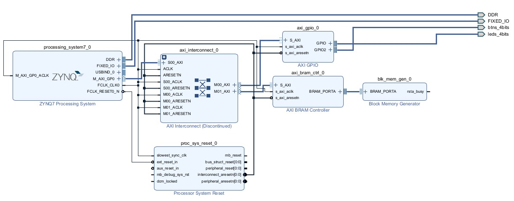
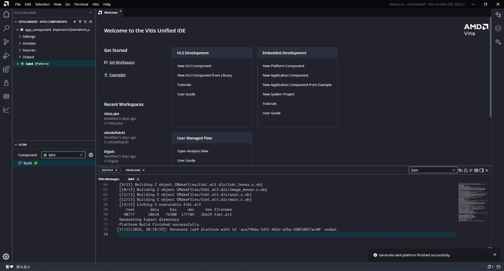

# Laboratorio 04
## Lab04: Implementación de un SoC Zynq-7000 mediante Vivado y Vitis

---

## Integrantes

- Juan Sebastián Florez Payares
- Juan Esteban Barrera Ortiz
- Carlos Andrés Herrera Molina
- Luciano Manrique Medina

**Grupo de trabajo:** 3  
**Semestre:** 2026-2

---

## Índice

- [Descripción del sistema](#descripción-del-sistema)
- [Herramientas utilizadas](#herramientas-utilizadas)
- [Implementación en Vivado](#implementación-en-vivado)
- [Desarrollo de la aplicación en Vitis](#desarrollo-de-la-aplicación-en-vitis)
- [Implementación en FPGA](#implementación-en-fpga)
- [Transferencia del archivo XSA entre computadores](#problemas-encontrados)
- [Análisis de resultados](#análisis-de-resultados)
- [Conclusiones](#conclusiones)
- [Referencias](#referencias)

---

## Descripción del sistema

En esta práctica se implementó un **System on Chip (SoC)** utilizando la tarjeta de desarrollo **Zybo Z7-10**, basada en la arquitectura Zynq-7000 de AMD.

El propósito del laboratorio fue comprender cómo se integran un sistema de procesamiento embebido y la lógica programable de una FPGA, utilizando las herramientas **Vivado y Vitis**.

A diferencia de los laboratorios anteriores, donde se desarrollaron módulos digitales mediante Verilog, en esta práctica se utilizó **IP Integrator**, una herramienta de Vivado que permite construir arquitecturas digitales mediante la interconexión de bloques funcionales previamente definidos.

El sistema implementado integra un procesador ARM Cortex-A9, memoria BRAM, periféricos GPIO y una interfaz de comunicación AXI, permitiendo que el procesador controle recursos físicos de la tarjeta mediante una aplicación desarrollada en lenguaje C.

Posteriormente, se utilizó Vitis para configurar la plataforma de hardware y ejecutar una aplicación proporcionada por el docente, cuyo funcionamiento se verificó mediante los botones y LEDs de la tarjeta.

---

## Herramientas utilizadas

| Herramienta | Aplicación |
|---|---|
| Zybo Z7-10 | Tarjeta utilizada para la implementación física. |
| AMD Vivado | Diseño y generación de la plataforma de hardware. |
| IP Integrator | Construcción del diagrama de bloques. |
| AMD Vitis | Configuración y ejecución de la aplicación embebida. |
| Lenguaje C | Aplicación proporcionada por el docente. |
| GitHub | Documentación y almacenamiento de archivos del laboratorio. |

---
## Implementación en Vivado

Para comenzar, se creó un proyecto en Vivado seleccionando la tarjeta **Zybo Z7-10**. Posteriormente, mediante la herramienta **IP Integrator**, se construyó la arquitectura del SoC utilizando los bloques proporcionados por Vivado.

El diseño integra el sistema de procesamiento **ZYNQ7 Processing System**, una interfaz de comunicación AXI, memoria BRAM y periféricos GPIO para los cuatro botones y cuatro LEDs de la tarjeta.

Se realizaron las conexiones correspondientes al reloj, las señales de reinicio y las interfaces AXI, permitiendo la comunicación entre el procesador y los periféricos implementados en la lógica programable.

En la siguiente imagen se observa el diagrama de bloques final del sistema:

*Figura 1. Arquitectura del SoC implementada mediante IP Integrator en Vivado.*

Una vez finalizadas las conexiones, se configuraron las direcciones de memoria mediante **Address Editor**, estableciendo un rango de **4 KB** para el periférico `/axi_gpio_0/S_AXI`.

Posteriormente, se generó el **HDL Wrapper** y se ejecutaron los procesos de síntesis, implementación y generación del **Bitstream**.

Finalmente, se exportó el diseño mediante un archivo `.xsa`, incluyendo el Bitstream, para utilizarlo como plataforma de hardware en Vitis.

---

## Desarrollo de la aplicación en Vitis

Después de finalizar el diseño de hardware, se utilizó **Vitis Unified IDE** para configurar la plataforma y preparar la ejecución de la aplicación.

Inicialmente, se creó un **Platform Component**, importando el archivo XSA generado previamente en Vivado. Posteriormente, se configuró el dominio de procesamiento correspondiente al sistema Zynq-7000.

Una vez creada la plataforma, se añadió un **Application Component**, incorporando el archivo `main.c` proporcionado por el docente.

El código utilizado permite controlar los LEDs de la tarjeta y leer el estado de los botones mediante los periféricos GPIO. Debido a que el programa fue suministrado como parte de la guía, el trabajo se concentró principalmente en la configuración e integración del hardware y software.

El código fuente se encuentra disponible en [main.c](src/main.c).

Posteriormente, se ejecutó el proceso de construcción de la plataforma en Vitis. En la siguiente imagen se observa que este proceso finalizó correctamente:

*Figura 2. Generación exitosa de la plataforma de hardware en Vitis Unified IDE 2025.2.*

La consola de Vitis muestra el mensaje `Platform Build Finished successfully`, confirmando que la generación de la plataforma se completó sin errores. Esta evidencia corresponde a la construcción de la plataforma y no a la compilación de la aplicación.

Finalmente, se utilizó Vitis para ejecutar la aplicación sobre la tarjeta **Zybo Z7-10**, comprobando el funcionamiento del sistema mediante sus botones y LEDs.

---

## Implementación en FPGA

La etapa final consistió en ejecutar la aplicación sobre la tarjeta **Zybo Z7-10**.

Para ello, se conectó la tarjeta al computador y se utilizó Vitis para cargar la configuración de hardware y ejecutar la aplicación.

El funcionamiento del sistema se verificó mediante los botones y LEDs disponibles en la tarjeta.

De acuerdo con el comportamiento establecido en la guía, los LEDs presentan un parpadeo cuando no se presiona ningún botón. Al mantener presionado uno de los botones, el LED correspondiente permanece encendido hasta que se libera.

A continuación se presenta el siguiente video de demostración del circuito: 

### Comportamiento del sistema

| Condición | Resultado esperado |
|---|---|
| Ningún botón presionado | Los LEDs parpadean. |
| BTN0 presionado | El LED correspondiente permanece encendido. |
| BTN1 presionado | El LED correspondiente permanece encendido. |
| BTN2 presionado | El LED correspondiente permanece encendido. |
| BTN3 presionado | El LED correspondiente permanece encendido. |
| Botón liberado | El LED retorna al comportamiento de parpadeo. |

Durante las pruebas se comprobó que el sistema funcionaba correctamente cuando la plataforma de hardware y la aplicación se utilizaban en el mismo computador donde se había generado el archivo XSA.

Sin embargo, se presentaron dificultades al transferir los archivos entre diferentes computadores, situación que se describe en la siguiente sección.

---

## Transferencia del archivo XSA entre computadores

Durante el desarrollo del laboratorio se presentó un inconveniente relacionado con la transferencia de los archivos del proyecto entre diferentes computadores.

Inicialmente, el diseño de hardware se realizaba en Vivado y posteriormente se exportaba mediante un archivo XSA para configurar la plataforma correspondiente en Vitis.

Sin embargo, se observó que, al transferir un archivo XSA generado en un computador e intentar utilizarlo en otro, la aplicación no lograba ejecutarse correctamente sobre la tarjeta Zybo Z7-10.

Este comportamiento se presentó en diferentes intentos de transferencia.

---

## Análisis de resultados

El desarrollo del laboratorio permitió comprender el proceso de implementación de un sistema embebido basado en la arquitectura Zynq-7000.

Mediante Vivado se construyó una arquitectura de hardware utilizando componentes previamente definidos, integrando el sistema de procesamiento ARM con periféricos GPIO y memoria BRAM mediante interfaces AXI.

A diferencia de los laboratorios anteriores, donde los módulos se implementaban principalmente mediante Verilog, en esta práctica se utilizó IP Integrator para realizar la integración del sistema a nivel de bloques.

Posteriormente, mediante Vitis, se configuró una plataforma de hardware a partir del archivo XSA y se incorporó la aplicación en lenguaje C suministrada por el docente.

Durante las pruebas realizadas en el computador donde se generó el diseño, se consiguió ejecutar correctamente la aplicación sobre la tarjeta Zybo Z7-10.

Esto permitió comprobar la integración entre el procesador y los periféricos implementados en la lógica programable.

Sin embargo, se identificó una dificultad importante al intentar reutilizar archivos XSA generados en otros computadores.

Aunque el diseño funcionaba correctamente en su entorno de origen, al transferirlo a otro equipo no se consiguió ejecutar la aplicación sobre la FPGA.

Este resultado evidenció la importancia de verificar no solamente la arquitectura implementada, sino también la configuración de la plataforma de software y su correspondencia con el hardware exportado.

En general, el laboratorio permitió comprender el flujo de trabajo necesario para desarrollar un sistema SoC, desde la construcción del hardware en Vivado hasta la ejecución de una aplicación embebida en Vitis.

---

## Conclusiones

- La implementación del SoC Zynq-7000 permitió comprender la integración entre un procesador ARM Cortex-A9 y la lógica programable de una FPGA, utilizando una arquitectura que combina hardware y software.

- La utilización de Vitis permitió comprender el proceso de creación de una plataforma de hardware y la ejecución de aplicaciones embebidas a partir del diseño exportado desde Vivado.

- En general, el laboratorio permitió comprender las principales etapas del desarrollo de sistemas embebidos sobre FPGA, incluyendo el diseño de hardware, la configuración de plataformas, la compilación de aplicaciones y la ejecución sobre un dispositivo físico.

---

## Referencias

[1] Digilent, *Zybo Z7 Reference Manual*.  
https://digilent.com/reference/programmable-logic/zybo-z7/reference-manual

[2] AMD, *Zynq 7000 SoC*.  
https://www.amd.com/es/products/adaptive-socs-and-fpgas/soc/zynq-7000.html

[3] FPGAs for Beginners, *Zynq Part 1: Vivado Block Diagram (No Verilog/VHDL Necessary!)*, YouTube, 2023.  
https://www.youtube.com/watch?v=UZ3FnZNlcWk
